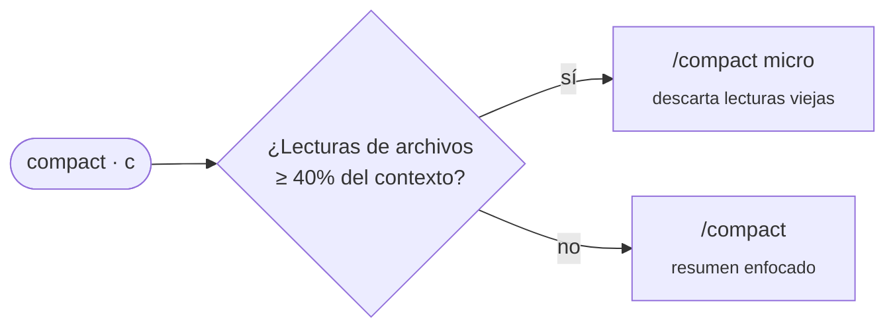

<div align="center">

# 💸 cc-cost

### Lo que tu sesión de Claude Code está gastando *de verdad* — en vivo, justo encima del prompt.

Tokens, contexto y las **ventanas de 5h / 7d** de tu suscripción — no dólares de API.

[](https://claude.com/claude-code)
[](#-instalación)
[](LICENSE)
[](#-privacidad)

[English](README.md) · [Português](README.pt-BR.md) · **Español**

<br>


<br>

<sub>⚡ cero configuración &nbsp;•&nbsp; 🔒 100% local &nbsp;•&nbsp; 🎯 compactación con una tecla &nbsp;•&nbsp; 🌈 límites por colores</sub>

</div>

---

## 🚀 Instalación

En el prompt de una sesión de Claude Code:

```
/plugin install cc-cost --marketplace edsoncantuaria/cc-cost
```

> [!TIP]
> Responde `y` para agregar el marketplace y elige el alcance. La barra aparece en el siguiente turno — nada que configurar.

---

## 🔎 Cómo leer la barra

| | Segmento | Significado |
| :-: | --- | --- |
| 🧮 | `19k tokens` | **Tokens nuevos** de la sesión: entrada + escritura de caché + salida |
| ↕️ | `↑ 19k  ↓ 30` | División entre entrada y salida |
| ♻️ | `cache 83%` | Parte de la entrada servida por lectura de caché — queda fuera del total, ya que reenvía el mismo contexto en cada petición |
| 📅 | `hoy 156k` | **Total del día** sumando todas las sesiones, guardado localmente por 7 días |
| ⏱️ | `5h 9%  7d 10%` | Ventanas de uso de la suscripción (y límite de gasto, si lo hay) |
| 🧠 | `ctx 111k/1,0M` | Contexto actual frente a la ventana del autocompact |
| 📈 | `▁▃▅█` | Sparkline de tokens nuevos por turno |
| 🗜️ | `[ compact ]` | Compactación con una tecla (`c`), eligiendo el modo más barato |
| 🤖 | subagentes | Cuántos corren y el mayor contexto entre ellos; sus tokens cuentan en el día, no en la sesión |

### 🚦 Colores

| Color | Ventanas de uso | Contexto |
| :-: | --- | --- |
| 🟢 | tranquilo | mucho espacio |
| 🟡 | subiendo — no lo pierdas de vista | cerca de la ventana de compactación |
| 🔴 | cerca del límite | compacta ya, antes del autocompact |

---

## 🌐 Idioma

La barra y sus avisos siguen el locale del sistema (`LC_ALL`, `LC_MESSAGES`, `LANG`): portugués, español o inglés para el resto. Para fijar uno, ajusta `cc-cost.language` en `/config` a `en`, `pt-BR` o `es` (`auto` es el valor por defecto).

---

## 🗜️ Compactación inteligente

El botón **compact** elige lo que cuesta menos:



> [!NOTE]
> El modo `micro` necesita el plugin micro-compaction. Sin él, el botón usa el `/compact` nativo y lo avisa.
> Cuando el contexto se pone 🔴, un toast indica qué modo usará el botón y cuánto libera.

---

## 🤔 ¿Por qué no ccusage?

|  | ccusage | **cc-cost** |
| --- | :-: | :-: |
| Mide | **dólares** de API | **ventanas** de la suscripción |
| Cuándo | después, a partir de logs | **en vivo**, dentro de la sesión |
| Dónde | comando aparte | **encima del prompt** |
| Contexto y compactación | — | ✅ |

En una suscripción Pro/Max la estimación en dólares no es lo que pagas — lo que importa es la **ventana de 5h, ahora mismo**.

---

## 📋 Requisitos

- Claude Code **2.1.287+** con mods (function hooks, acceso anticipado).
- *Opcional:* el plugin micro-compaction para el modo `micro`.

## 🛠️ Desarrollo

```bash
git clone https://github.com/edsoncantuaria/cc-cost ~/.claude/mods/cc-cost
claude plugin validate ~/.claude/mods/cc-cost   # revisa manifiesto + hooks
claude plugin test     ~/.claude/mods/cc-cost   # corre las pruebas
claude --plugin-dir    ~/.claude/mods/cc-cost   # pruébalo en una sesión
```

Para cargar el clon en todas las sesiones, define `CLAUDE_CODE_PLUGIN_DIRS` con la carpeta en el bloque `env` de `~/.claude/settings.json` y reinicia Claude Code.

> [!WARNING]
> Copiar la carpeta no basta para cargarlo. Y no combines el clon local con la instalación por marketplace, o la barra aparecerá dos veces.

## 🔒 Privacidad

Sin red y sin telemetría. Solo lee el uso de la sesión que Claude Code ya proporciona y guarda contadores diarios en el store local del mod.

---

<div align="center">

Hecho con ☕ por [@edsoncantuaria](https://github.com/edsoncantuaria) · [MIT](LICENSE)

<sub>Si te salvó la ventana de 5h, deja una ⭐</sub>

</div>
