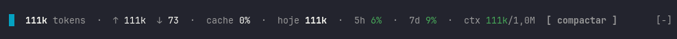
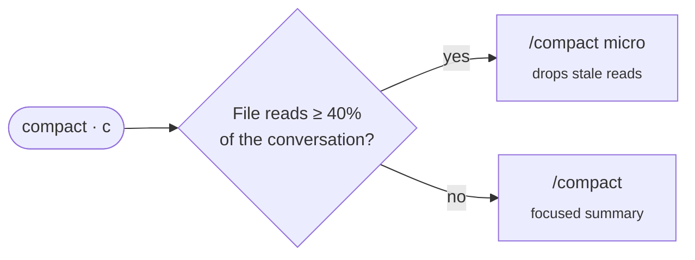

<div align="center">

# 💸 cc-cost

### What your Claude Code session is *really* spending — live, right above the prompt.

Tokens, context and your subscription's **5h / 7d windows** — not API dollars.

[](https://claude.com/claude-code)
[](#-install)
[](LICENSE)
[](#-privacy)

**English** · [Português](README.pt-BR.md) · [Español](README.es.md)

<br>



<br>

<sub>⚡ zero config &nbsp;•&nbsp; 🔒 100% local &nbsp;•&nbsp; 🎯 one-key compaction &nbsp;•&nbsp; 🌈 color-coded limits</sub>

</div>

---

## 🚀 Install

At the prompt of a Claude Code session:

```
/plugin install cc-cost --marketplace edsoncantuaria/cc-cost
```

> [!TIP]
> Answer `y` to add the marketplace, then pick a scope. The band shows up on the next turn — nothing to configure.

---

## 🔎 Reading the band

| | Segment | Meaning |
| :-: | --- | --- |
| 🧮 | `19k tokens` | **New tokens** in the session: input + cache writes + output |
| ↕️ | `↑ 19k  ↓ 30` | Input / output split |
| ♻️ | `cache 83%` | Share of input served from cache reads — left out of the total, since they resend the same context every request |
| 📅 | `today 156k` | **Today's total** across every session, kept locally for 7 days |
| ⏱️ | `5h 9%  7d 10%` | Subscription usage windows (and spend limit, when set) |
| 🧠 | `ctx 111k/1.0M` | Current context against the auto-compact window |
| 📈 | `▁▃▅█` | Sparkline of new tokens per turn |
| 🗜️ | `[ compact ]` | One-key (`c`) compaction, picking the cheaper mode |
| 🤖 | subagents | Count and largest context while they run; their tokens count toward today, not the session |

### 🚦 Colors

| Color | Usage windows | Context |
| :-: | --- | --- |
| 🟢 | comfortable | plenty of room |
| 🟡 | rising — keep an eye on it | getting close to the compaction window |
| 🔴 | close to the limit | compact now, before autocompact kicks in |

---

## 🌐 Language

The band and its notices follow your system locale (`LC_ALL`, `LC_MESSAGES`, `LANG`): Portuguese, Spanish, or English for anything else. To pin one, set `cc-cost.language` in `/config` to `en`, `pt-BR` or `es` (`auto` is the default).

---

## 🗜️ Smart compaction

The **compact** button picks what costs less:



> [!NOTE]
> `micro` needs the micro-compaction plugin. Without it, the button falls back to the native `/compact` and tells you so.
> When the context turns 🔴, a toast says which mode the button will use and, for micro, how much of the conversation is file reads.

---

## 🤔 Why not ccusage?

|  | ccusage | **cc-cost** |
| --- | :-: | :-: |
| Measures | API **dollars** | subscription **windows** |
| When | after the fact, from logs | **live**, inside the session |
| Where | separate command | **above the prompt** |
| Context & compaction | — | ✅ |

On a Pro/Max subscription the dollar estimate isn't what you pay — the limit that matters is the **5h window, right now**.

---

## 📋 Requirements

- Claude Code **2.1.287+** with mods (function hooks, early access).
- *Optional:* the micro-compaction plugin for `micro` mode.

## 🛠️ Development

```bash
git clone https://github.com/edsoncantuaria/cc-cost ~/.claude/mods/cc-cost
claude plugin validate ~/.claude/mods/cc-cost   # check manifest + hooks
claude plugin test     ~/.claude/mods/cc-cost   # run the test suite
claude --plugin-dir    ~/.claude/mods/cc-cost   # try it in one session
```

To load the clone in every session, set `CLAUDE_CODE_PLUGIN_DIRS` to its folder in the `env` block of `~/.claude/settings.json` and restart Claude Code.

> [!WARNING]
> Copying the folder alone doesn't load it. And don't combine a local clone with the marketplace install, or the band is drawn twice.

### Code layout

| File | Owns |
| --- | --- |
| `hooks/register.tsx` | wiring only: which event calls what |
| `hooks/accounting.ts` | token counting, the daily store, context thresholds |
| `hooks/compaction.ts` | the compact button's policy (micro vs. summary), the 🔴 notice, the micro-compaction contract |
| `hooks/band.tsx` | drawing the band |
| `hooks/texts.ts` | translations and number formatting |
| `hooks/state.ts` | the session state (`$.state` atoms); the only file that reads or writes it |
| `hooks/runtime.ts` | write ordering and `safe`, which keeps a failure of the mod out of your turn |

Everything the mod remembers lives in the session's `$.state` (or `$.store` for the daily totals), so a hot reload keeps it; the module itself holds no mutable state. What cc-cost assumes about the micro-compaction plugin (which ships no types) is gathered in one `MICRO` object in `compaction.ts`.

## 🔒 Privacy

No network, no telemetry. It only reads the session usage Claude Code already provides and keeps daily counters in the mod's local store.

---

<div align="center">

Made with ☕ by [@edsoncantuaria](https://github.com/edsoncantuaria) · [MIT](LICENSE)

<sub>If it saves your 5h window, leave a ⭐</sub>

</div>
