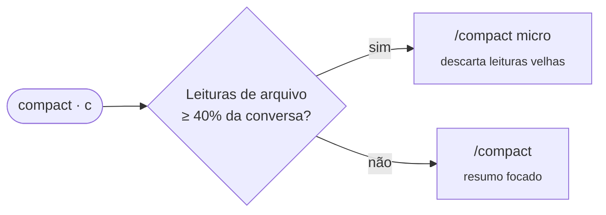

<div align="center">

# 💸 cc-cost

### O que sua sessão do Claude Code está usando — ao vivo, logo acima do prompt.

Tokens, contexto e as **janelas de 5h / 7d** da assinatura — não dólares de API.

[](https://claude.com/claude-code)
[](#-instalação)
[](LICENSE)
[](#-privacidade)

[English](README.md) · **Português** · [Español](README.es.md)

<br>


<br>

<sub>⚡ zero configuração &nbsp;•&nbsp; 🔒 100% local &nbsp;•&nbsp; 🎯 compactação com uma tecla &nbsp;•&nbsp; 🌈 limites coloridos</sub>

</div>

---

## 🚀 Instalação

No prompt de uma sessão do Claude Code:

```
/plugin install cc-cost --marketplace edsoncantuaria/cc-cost
```

> [!TIP]
> Responda `y` para adicionar o marketplace e escolha o escopo. A faixa aparece no próximo turno — nada para configurar.

---

## 🔎 Lendo a faixa

| | Trecho | Significado |
| :-: | --- | --- |
| 🧮 | `19k tokens` | **Tokens novos** da sessão: entrada + escrita de cache + saída. É volume, não sua cota: cada tipo pesa diferente nas janelas, então o gasto real é o % de `5h` / `7d` |
| ↕️ | `↑ 19k  ↓ 30` | Divisão entre entrada e saída |
| ♻️ | `cache 83%` | Parcela da entrada servida por leitura de cache — fica fora do total, pois reenvia o mesmo contexto a cada requisição |
| 📅 | `hoje 156k` | **Total do dia** somando todas as sessões, guardado localmente por 7 dias |
| ⏱️ | `5h 9%  7d 10%` | Janelas de uso da assinatura (e limite de gasto, se houver) |
| 🧠 | `ctx 111k/1,0M` | Contexto atual contra a janela do autocompact |
| 📈 | `▁▃▅█` | Sparkline de tokens novos por turno |
| 🗜️ | `[ compact ]` | Compactação com uma tecla (`c`), escolhendo o modo mais barato |
| 🤖 | subagentes | Quantos rodam e o maior contexto entre eles; os tokens entram no dia, não na sessão |

### 🚦 Cores

| Cor | Janelas de uso | Contexto |
| :-: | --- | --- |
| 🟢 | tranquilo | bastante espaço |
| 🟡 | subindo — fique de olho | chegando perto da janela de compactação |
| 🔴 | perto do limite | compacte agora, antes do autocompact |

---

## 🌐 Idioma

A faixa e os avisos seguem o locale do sistema (`LC_ALL`, `LC_MESSAGES`, `LANG`): português, espanhol ou inglês para o resto. Para fixar um, ajuste `cc-cost.language` no `/config` para `en`, `pt-BR` ou `es` (`auto` é o padrão).

---

## 🗜️ Compactação inteligente

O botão **compact** escolhe o que custa menos:



> [!NOTE]
> O modo `micro` precisa do plugin micro-compaction. Sem ele, o botão usa o `/compact` nativo e avisa.
> Quando o contexto fica 🔴, um toast diz qual modo o botão vai usar e, no micro, quanto da conversa é leitura de arquivo.

---

## 🤔 Por que não o ccusage?

|  | ccusage | **cc-cost** |
| --- | :-: | :-: |
| Mede | **dólares** de API | **janelas** da assinatura |
| Quando | depois, a partir de logs | **ao vivo**, dentro da sessão |
| Onde | comando separado | **acima do prompt** |
| Contexto e compactação | — | ✅ |

Na assinatura Pro/Max a estimativa em dólar não é o que você paga — o que importa é a **janela de 5h, agora**.

---

## 📋 Requisitos

- Claude Code **2.1.287+** com mods (function hooks, acesso antecipado).
- *Opcional:* o plugin micro-compaction para o modo `micro`.

## 🛠️ Desenvolvimento

```bash
git clone https://github.com/edsoncantuaria/cc-cost ~/.claude/mods/cc-cost
claude plugin validate ~/.claude/mods/cc-cost   # confere manifesto + hooks
claude plugin test     ~/.claude/mods/cc-cost   # roda os testes
claude --plugin-dir    ~/.claude/mods/cc-cost   # testa numa sessão
```

Para carregar o clone em toda sessão, defina `CLAUDE_CODE_PLUGIN_DIRS` com a pasta no bloco `env` de `~/.claude/settings.json` e reinicie o Claude Code.

> [!WARNING]
> Só copiar a pasta não carrega o mod. E não combine o clone local com a instalação pelo marketplace, senão a faixa aparece duas vezes.

### Organização do código

| Arquivo | Responsável por |
| --- | --- |
| `hooks/register.tsx` | só a ligação: qual evento chama o quê |
| `hooks/accounting.ts` | contagem de tokens, o store diário, os limiares de contexto |
| `hooks/compaction.ts` | a política do botão compact (micro ou resumo), o aviso 🔴, o contrato com o micro-compaction |
| `hooks/band.tsx` | o desenho da faixa |
| `hooks/texts.ts` | traduções e formatação de números |
| `hooks/state.ts` | o estado da sessão (atoms do `$.state`); o único arquivo que o lê ou escreve |
| `hooks/runtime.ts` | a ordem das escritas e o `safe`, que impede uma falha do mod de chegar ao seu turno |

Tudo o que o mod guarda fica no `$.state` da sessão (ou no `$.store`, para os totais do dia), então sobrevive a hot reload; o módulo em si não tem estado mutável. O que o cc-cost supõe sobre o plugin micro-compaction (que não publica tipos) está reunido num objeto `MICRO`, em `compaction.ts`.

## 🔒 Privacidade

Sem rede e sem telemetria. Só lê o uso da sessão que o Claude Code já fornece e guarda contadores diários no store local do mod.

---

<div align="center">

Feito com ☕ por [@edsoncantuaria](https://github.com/edsoncantuaria) · [MIT](LICENSE)

<sub>Se ele salvou sua janela de 5h, deixa uma ⭐</sub>

</div>
